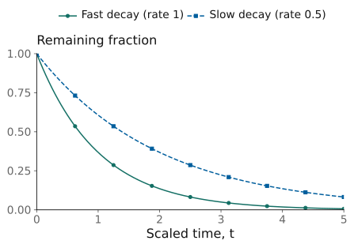

Make the science easy to read, compare, and reuse. This guide brings the same restrained typography, stable visual mappings, and generous spacing to scientific figures, diagrams, and their host slides.

**The order of priorities is scientific fidelity, readability at the final size, portability, then visual consistency.** A restyle changes presentation. It preserves measurements, units, uncertainty, scales, reference lines, chemical notation, and meaningful geometry.

## A worked example

**Illustrative mathematical example.** These curves follow `f(t) = exp(-k t)`, with rates `k = 1` and `k = 0.5`. Time is dimensionless. The symbols sample the formulas and distinguish the series. This example uses analytical curves with no experimental observations or measurement uncertainty.

<picture>
  <source width="390" height="483" media="(max-width: 540px)" srcset="../assets/figures/decay-example-mobile_slide-light.svg">
  
</picture>

The marks carry the comparison. The local key matches both line style and marker shape. The vertical quantity label reads horizontally. On a narrow screen, the key and plotting region reflow while the formulas, ranges, and series identities stay the same.

| Layout | Transparent light-slide artwork | White print artwork |
| --- | --- | --- |
| Wide example | 780 × 548 px · [SVG](../assets/figures/decay-example_slide-light.svg) / [PDF](../assets/figures/decay-example_slide-light.pdf) | 140 × 97.75 mm · [SVG](../assets/figures/decay-example_print.svg) / [PDF](../assets/figures/decay-example_print.pdf) |
| Narrow example | 390 × 483 px · [SVG](../assets/figures/decay-example-mobile_slide-light.svg) / [PDF](../assets/figures/decay-example-mobile_slide-light.pdf) | 140 × 135.95 mm · [SVG](../assets/figures/decay-example-mobile_print.svg) / [PDF](../assets/figures/decay-example-mobile_print.pdf) |

Print widths are provisional examples. Both layouts use about 28 px axis labels and 24 px ticks and keys at their declared slide widths. Print uses about 10 pt labels and 8 pt ticks and keys. The narrow composition has separately tuned print spacing. Select the layout that fits the actual destination.

The example contains editable SVG text and vector marks, embedded DM Sans Regular in SVG, and embedded subset fonts in PDF. There is no raster content or remote asset dependency. The font is supplied under the [SIL Open Font License](../assets/figures/DMSans-OFL.txt). Install DM Sans to edit labels in another application. Support for embedded SVG fonts varies between editors. Dimensions are also recorded in the [wide](../assets/figures/decay-example.handoff.json) and [narrow](../assets/figures/decay-example-mobile.handoff.json) handoffs.

## Typography and color

Use **DM Sans Regular** for axes, ticks, legends, and annotations. Reserve bold for sparse panel identifiers or a short meaningful emphasis. **DM Serif Text Regular** can introduce a standalone figure or slide. **DM Serif Display Regular** belongs on covers. Preserve specialist math and symbol fonts when the scientific notation requires them.

Use dark ink `#141414`, essential secondary gray `#666666`, and white space. For a new comparison, teal `#136F64` and blue `#005E9D` are useful starting colors. Existing scientific mappings take precedence. An atom, reference, assay category, or model keeps its meaning across related figures.

Pair color with markers, dashes, hatches, or direct labels. Check the actual marks together in grayscale and under color-vision simulations. A palette alone cannot guarantee distinguishability. Never rely on pale accents as thin lines against white.

## Size for the destination

Choose the intended placement before tuning the figure. The following sizes are starting points. Follow the publisher’s requirements for the final document.

| Element | On a 1920 × 1080 slide | At final print size |
| --- | --- | --- |
| Axis labels and main annotations | 28–32 px | 9–11 pt |
| Ticks and legends | 24–28 px | 8–10 pt |
| Panel identifiers | 28–32 px, sparse bold | 10–12 pt, sparse bold |
| Supporting captions and checkpoint notes | 18–22 px | 7.5–8.5 pt |
| Optional standalone heading | 36–44 px | 11–14 pt |

Dense results can use a compact scale when the plot remains dominant. Start with **20 px labels, 17 px ticks and keys, 22 px panel headings, and 15 px supporting notes** at full slide width. Corresponding print sizes are 8.5, 7.25, 9.5, and 7 pt. Inspect them at the real placement. Split a crowded figure before reducing its type further.

A slide has room for roughly a 780 px half-width slot or a 1640 px full-width slot. Titles and captions reduce the usable height. Print needs an explicit physical width. Declare an assumption if none is supplied. Size print typography independently from slide pixels.

## Compose the comparison

Keep labels horizontal where practical. Use sparse major gridlines, clean axes, aligned plot regions, and space between groups. Preserve intentional scale differences and label them. Preserve chemical bonds, stereochemistry, reaction direction, symbols, and image aspect ratios.

For dense multi-panel results, **stack equal-width comparisons in their scientific reading order**. Give the shared legend a measured column or a separate clear region. Export independently readable panels with their own relevant keys, uncertainty explanations, and checkpoint identifiers. Keep a matrix together when its row and column alignment conveys the comparison, and supply focused row or panel views.

The legend names the variable encoded by color, such as model, configuration, or seed. Lead with the identity key, then adaptations, references, and additional symbols. Match samples to the actual marks, including fill, outlines, hatches, and dashes. Wrap long entries at word boundaries. A standalone key includes only the series that appear in that panel.

Supporting explanations can be smaller, but need space outside the marks. Keep necessary measurement keys with their plots. Put the title and prose caption in the host document when it already supplies them. Preserve all scientific detail by reflowing or splitting before squeezing labels.

## Export reusable artwork

Deliver matching SVG and PDF files for each required mode.

| Mode | Naming | Surface |
| --- | --- | --- |
| Light slide | `name_slide-light.svg` and `.pdf` | Transparent, with dark ink |
| Print or document | `name_print.svg` and `.pdf` | Explicit solid white, with dark ink |
| Known dark destination, when needed | `name_slide-dark.svg` and `.pdf` | Transparent, with labels and marks checked on that background |

Keep paper grain, slide texture, borders, page numbers, and host captions outside reusable figures. Give each artboard a content-appropriate aspect ratio and enough padding for labels and strokes. Do not stretch the geometry to fit a slide.

SVGs need explicit dimensions, a correct viewBox, editable text, and documented font dependencies. Distinguish a declared font family from an embedded font. PDFs need embedded or subset fonts, selectable text, and tightly sized pages. Preserve real raster scientific imagery at adequate effective resolution, normally at least 300 ppi for continuous-tone print images, with vector labels. Use sRGB unless the destination specifies another profile.

## Host slides

The reference canvas is 1920 × 1080. A useful grid has 140 px side margins and an 80 px gutter between two 780 px columns. Keep at least 60 px below the rendered heading. Reserve lower space for credits and navigation. Use related spacing increments of 20, 40, 60, 80, and 120 px.

Use DM Serif Display Regular at 140 px for a cover statement. For ordinary headings, choose DM Serif Text Regular at 90 px, or 60 px beneath a 24 px eyebrow. DM Sans body starts at 32 px. Supporting points can use 44 px and captions 20–24 px. Size plot labels for their own placement. Left-align ordinary prose and favor white space over cards, shadows, and heavy dividers. Keep textures subtle and supplied by the host. Retain original assets when reproducing a specific template.

## Before sharing

Compare a restyle with its original using the same data, selection, and evaluation. Clearly label mathematical or synthetic illustrations. If new observations have arrived, disclose the change instead of presenting the rebuild as an identical historical result.

Inspect both SVG and PDF at the declared slide and print sizes. Check clipping, glyphs, label collisions, uncertainty, legend mappings, and contrast on the intended surface. Check grayscale and color-vision differences. Document sizes, fonts, raster resolution, provisional assumptions, and anything the destination application has not yet verified.

The example above was inspected as browser-rendered SVG and rendered PDF at its intended sizes. It uses hue-independent marker and dash encodings. Placement and font editing in presentation and illustration applications still need to be checked in those applications.
